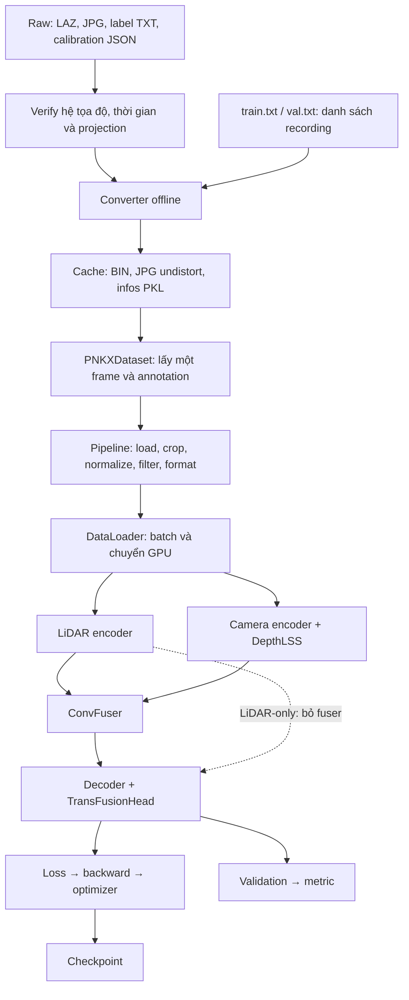

# Giải thích luồng PNKX: verify → raw → dataset → LiDAR-only → fusion

> **Cập nhật profile nuScenes:** Các thông số/kết quả bên dưới mô tả bản debug
> BEV 128 cũ. Xem [profile mới và cách chạy](pnkx-nuscenes-profile.md) cho BEV 180,
> FP16, CBGS, augmentation và lịch train theo nuScenes. Đã sửa thêm quy ước
> LWH/yaw → WLH/yaw legacy ở dataset; checkpoint debug cũ cần train lại.
> Các lệnh wrapper có hậu tố `-debug` dưới đây dùng config debug hiện hành.


Tên chuẩn hiện tại là **PNKX**. Các kết quả train/verify ngày 19/10/2026 bên dưới
là lịch sử của mẫu VF6_01. Converter hiện đã map camera sau VF6_03 từ
`CAM_P_B_New`, dùng calibration cùng tên; xem profile mới bên dưới.
Xem [đối chiếu PNKX/nuScenes và trạng thái split mới](pnkx-vs-nuscenes.md).
Các link `runs/pnxk-*`, `outputs/pnxk-*` được giữ để trỏ đúng artifact lịch sử.

Tài liệu này giải thích code đang có trong repo, từ dữ liệu trên ổ đĩa tới
trọng số model. Ngày rà soát: 19/10/2026. Các ví dụ số lấy từ chunk mẫu hiện tại.
Các lệnh chạy đầy đủ nằm trong [pnkx-fusion-from-raw.md](pnkx-fusion-from-raw.md).

## 1. Trước hết: có ba quá trình khác nhau

| Quá trình | Đầu vào | Đầu ra | Có học trọng số không? |
| --- | --- | --- | --- |
| Verify | Raw, label, calibration | Thống kê, ảnh point/box/projection | Không |
| Convert offline | Raw + split TXT + calibration | Point BIN, ảnh undistort, metadata PKL | Không |
| Train online | Cache + config | Loss, trọng số, checkpoint | Có |

“Offline” nghĩa là làm trước khi train và lưu kết quả lên đĩa. “Online” ở đây
nghĩa là thực hiện mỗi lần dataset được lấy ra trong quá trình train, không có
nghĩa là kết nối Internet.

Verify không tạo ra model. Convert cũng không tạo ra model. Model chỉ thay đổi
trọng số khi thực hiện backward và optimizer step trong train.



## 2. Những từ và ký hiệu cần biết

- **Recording**: một phiên ghi dữ liệu. **Chunk**: một đoạn trong recording.
- **Frame/sample**: một thời điểm có label, kèm một cloud TOP và sáu ảnh ghép thời gian.
- **Batch**: nhóm sample xử lý trong một iteration. Hiện batch bằng 1.
- **Epoch**: một lượt đi qua dataset train. Dataset 171 sample, batch 1 thì một epoch
  có 171 iteration ở chế độ một GPU hiện tại.
- **GT / ground truth**: box và class do người gán nhãn cung cấp.
- **Feature**: đặc trưng số do mạng học, khác tọa độ vật lý hay pixel RGB.
- **BEV**: biểu diễn nhìn từ trên xuống, chia mặt phẳng quanh xe thành các ô.
- **Tensor**: mảng nhiều chiều. `[B,N,C,H,W]` nghĩa là batch, camera, channel, cao, rộng.

Trong tài liệu, `T_A_from_B` là ma trận đưa tọa độ từ B về A, dùng vector cột:

```text
p_A = T_A_from_B × p_B
```

Ma trận 4×4 chứa rotation R và translation t. Với mảng NumPy `[N,3]`, mỗi điểm
là một hàng nên cùng phép biến đổi được viết:

```python
points_A = points_B @ R.T + t
```

## 3. Verify: vì sao phải làm trước khi viết adapter?

Một mạng có thể chạy và giảm loss dù box/point/camera đang lệch hệ tọa độ.
Vì vậy cần chứng minh các thông tin hình học hợp lý trước khi nối vào model.

### 3.1. Thống kê cấu trúc và label

Đầu vào: cây `Data-PNKX/data`, `label`, `split` và JSON calibration.

Đã xác nhận trong mẫu:

- Một recording, một chunk; 171 file label.
- 12 camera raw, nhưng chọn sáu CAM_P cho model fusion hiện tại.
- Năm LiDAR raw, nhưng model hiện tại chỉ dùng LIDAR_TOP.
- Mỗi dòng label có 11 trường; ba class Car/Rider/Pedestrian.
- Kích thước box dương; yaw khoảng `[-π,π]`.
- Có box có số điểm bằng 0 và có box ngoài phạm vi train.

Đầu ra: thống kê để quyết định schema, class và phạm vi; chưa loại box chỉ vì
annotation ghi point-count bằng 0.

### 3.2. Xác nhận hệ tọa độ

Theo chủ dữ liệu:

```text
ego: x trước, y trái, z lên, mét
box: tâm hình học, length/width/height, yaw radian
yaw=0: length hướng +x; yaw dương quay về +y
point LAZ: nằm trong sensor frame
```

Box đã nằm trong ego. Vì vậy đưa point về ego; không áp lại extrinsics LiDAR
lên box vốn đã ở ego.

### 3.3. Xác nhận timestamp

Tên `1772252610-099740267.txt` được parse thành số nguyên nanosecond:

```text
1772252610 × 1.000.000.000 + 099740267
= 1772252610099740267
```

Dùng số nguyên để chọn file gần nhất, tránh mất độ chính xác khi ghép bằng float.
Kết quả: 171/171 label khớp TOP tuyệt đối. Camera thường lệch vài ms; LB/RB có
frame khoảng 33 ms. Vì thế camera không thể ghép bằng yêu cầu tên file trùng nhau.

### 3.4. Xác nhận chiều camera extrinsics

Đã thử hai giả thuyết trên cùng ảnh: dùng trực tiếp camera matrix hoặc nghịch đảo.
Dùng trực tiếp làm ego → camera cho point/box khớp cảnh; nghịch đảo gây lệch rõ.
Với calibration mẫu:

```text
TOP JSON:    sensor → ego
camera JSON: ego → optical camera
```

Hai nhóm ma trận không có cùng chiều. Đây là lý do adapter phải xử lý riêng.
Kết luận dựa trên quan sát mẫu; chưa thay thế tài liệu calibration cho mọi xe/ngày.

### 3.5. Đọc LAZ, vẽ BEV và projection

Script khảo sát lưu ở `outputs/pnxk-inspection/inspect_pnxk.py`; ảnh và số liệu
ở cùng thư mục, được gitignore. Script khảo sát là công cụ cho chunk mẫu,
không phải converter tổng quát dùng train.

- Đọc LAZ bằng laspy/lazrs.
- Transform cloud TOP sang ego.
- Tạo tám góc của mỗi box, quay theo yaw rồi cộng tâm ego.
- Vẽ point/box từ trên xuống.
- Undistort thử ảnh CAM_P bằng mô hình chuẩn OpenCV; dùng K và extrinsics chiếu
  point/góc box lên ảnh, so hai chiều camera matrix.

Đã xem ba frame đầu/giữa/cuối và sáu camera. Alignment hợp lý; lens model chuẩn
OpenCV vẫn là giả định đã thử có kết quả hợp lý, chưa được xác nhận độc lập bằng
calibration reprojection error.

## 4. Converter: biến thư mục raw thành thứ train đọc được

Code: [`tools/data_converter/pnkx_converter.py`](../tools/data_converter/pnkx_converter.py).
Converter chạy độc lập với mmcv/mmdet và không dùng GPU.

### 4.1. Đọc split và duyệt recording/chunk

Input: `train.txt`, `val.txt`, `--root Data-PNKX`.

`read_split()` lấy recording name từ dòng TXT, chấp nhận tên thuần hoặc đường
dẫn cũ kết thúc ở recording. Kiểm tra recording tồn tại và không lặp trong một file.

`convert()` kiểm tra overlap train/val rồi thực hiện:

```python
for split in (train, val):
    for recording in recording_list:
        for chunk in recording:
            for label_timestamp in chunk:
                build_one_sample()
```

Output của bước này là danh sách sample thuộc đúng split ban đầu. Không sinh
split mới theo frame/chunk. Khi debug overlap được cho phép rõ bằng flag; memo
tránh convert lại cùng sample hai lần, nhưng cả hai metadata vẫn tham chiếu sample đó.

### 4.2. Chọn calibration

`calibration()` lấy ngày/xe từ tên recording. Ví dụ
`20260228_1105_VF6_01_...` → ngày 2026-02-28, xe VF6_01.

Nếu có JSON theo ngày, chọn đúng một khoảng `[valid_from, valid_to)`. Nếu không
có file theo ngày, đọc JSON extrinsics tĩnh của xe. Không có khoảng hợp lệ thì
báo lỗi, không lấy tùy ý khoảng gần nhất.

Kiểm tra sensor có ma trận, shape 4×4, giá trị hữu hạn, hàng cuối và tính trực
giao rotation. Kiểm tra cấu trúc không tự chứng minh ma trận đúng chiều vật lý;
phần verify projection mới cung cấp bằng chứng cho điều đó.

### 4.3. Ghép một frame

`sensor_index()` sắp file theo timestamp. `nearest()` tìm file gần timestamp label
nhất bằng bisect, sau đó so ngưỡng:

- TOP tối đa 1 ms mặc định.
- Mỗi camera tối đa 40 ms mặc định.

Input là một timestamp label. Output là một đường dẫn TOP và sáu đường dẫn ảnh,
kèm độ lệch từng sensor. Không interpolation, deskew hoặc bù chuyển động.

Ví dụ frame đầu `1772252610-099740267`: TOP khớp tuyệt đối; sáu CAM_P gần nhất
đều lệch khoảng 1,616 ms. Ghép timestamp tốt không đồng nghĩa đã chứng minh
đồng bộ phần cứng hay timestamp từng point trong vòng quét.

### 4.4. Point LAZ → BIN ego

Input: LAZ TOP ở hệ sensor, ma trận TOP sensor → ego.

```python
cloud = laspy.read(path)
xyz_sensor = np.column_stack((cloud.x, cloud.y, cloud.z))
xyz_ego = xyz_sensor @ R.T + t
points = [x_ego, y_ego, z_ego, intensity_raw, 0]
```

`cloud.x/y/z` đã áp scale/offset LAS; khác với trường nguyên `X/Y/Z`.
Intensity giữ nguyên. Cột cuối là thời gian lệch sweep, bằng 0 vì chỉ có một sweep;
đây không phải velocity hay track ID. Ring và point_timestamp raw chưa dùng.

Ví dụ point đầu frame mẫu:

```text
raw sensor XYZ: [-5.105, 0.485, -1.060]
cache ego:     [-4.202688, 0.395834, 0.815500, 64, 0]
```

Output: BIN float32, mỗi point 5 số. File không có header; loader phải biết
`load_dim=5`. Khi rà lại đã so toàn bộ 216.495 point frame đầu với raw sau transform,
đồng thời so intensity: khớp trong sai số float32.

### 4.5. Ảnh raw → ảnh undistort

Input: JPG raw 1920×1536, K, distortion coefficients.

```python
rectified = cv2.undistort(image, K, distortion, None, K)
```

Giữ kích thước ảnh và K mới bằng K gốc; lưu JPG riêng trong cache. Đây là xử lý
méo lens, chưa phải resize/crop cho network. OpenCV đọc/ghi BGR nhất quán;
loader train mở JPG bằng PIL thành RGB rồi normalize.

Output: sáu ảnh đã xử lý méo và metadata K tương ứng. Model không tự đọc JSON
distortion và không tự undistort lại mỗi iteration.

### 4.6. Label và metadata

`read_labels()` đọc đủ 11 trường, kiểm tra class/kích thước/giá trị, giữ box
`[x,y,z,length,width,height,yaw]` ở tâm hình học. Car → car, Rider → rider,
Pedestrian → pedestrian; không tách ngược các class đã gộp của dữ liệu.

Occlusion, point-count và track_id được lưu để tham khảo; hiện không dùng làm
trọng số loss, không lọc zero-point và không train tracking.

Một metadata sample chứa:

```text
token = recording/chunk/label_timestamp
recording, chunk, timestamp_ns
lidar_path: đường dẫn tương đối tới BIN ego
num_points
gt_boxes: M×7, tâm hình học
gt_names: M class name
cams: sáu phần tử theo thứ tự cố định
  name, data_path, ego2camera, intrinsic, delta_ms
occlusion, annotation_num_points, track_ids
```

PKL chứa `metadata` (schema, class, point frame, recording, overlap...) và `infos`
(danh sách sample). `portable_metadata()` đổi NumPy array sang Python list trước
pickle để cache tạo bởi NumPy mới trên host không phụ thuộc module nội bộ NumPy
khác phiên bản trong container.

Hai file PKL chỉ là bảng tra cứu: chúng không chứa toàn bộ ảnh/point và không chứa
trọng số model. BIN/JPG lưu dữ liệu lớn; PKL cho biết lấy ở đâu và hiểu như thế nào.

## 5. Dataset: từ một dòng infos tới dữ liệu một frame

Code: [`mmdet3d/datasets/pnkx_dataset.py`](../mmdet3d/datasets/pnkx_dataset.py).
Đăng ký trong `mmdet3d/datasets/__init__.py` để config có thể gọi `type: PNKXDataset`.

Input: PKL, cache root, config pipeline/modality. Output: dict chuẩn mà pipeline
của repo hiểu được. Dataset không tự đọc LAZ và không undistort ảnh.

### 5.1. `load_annotations()`

Đọc PKL, kiểm tra schema/frame/classes, tạo lại NumPy array. Nếu bật camera
nhưng cache không có camera thì báo lỗi.

Class ID theo thứ tự cố định:

```text
car=0, rider=1, pedestrian=2
```

Không dùng nguyên 10 class nuScenes, không gán Rider tùy ý sang riêng motorcycle.

### 5.2. `get_ann_info()` và tâm box

Cache giữ tâm hình học, framework nội bộ dùng tâm đáy. Dùng:

```python
internal = raw_boxes_to_internal(boxes)
LiDARInstance3DBoxes(internal, box_dim=7, origin=(0.5, 0.5, 0.5))
```

Constructor chuyển đúng một lần về origin nội bộ `(0.5,0.5,0)`.

Ví dụ box đầu frame mẫu:

```text
label:  x=9.0578, y=0.9991, z_center=0.6992, height=1.5288
internal z_bottom = 0.6992 - 1.5288/2 = -0.0652
```

X/y và hệ trục ego giữ nguyên. Tuy nhiên, phiên bản `LiDARInstance3DBoxes` trong
repo này dùng thứ tự kích thước **width, length, height** và quy ước góc khác label.
`raw_boxes_to_internal()` trong `mmdet3d/datasets/pnkx_geometry.py` đổi
`[length,width,height,yaw_raw]` thành `[width,length,height,-yaw_raw-π/2]`, giống
converter nuScenes của repo. Ví dụ yaw raw bằng 0, xe dài theo +x, phải thành
yaw nội bộ −π/2. Sau phép đổi này tám góc vật lý của box vẫn giữ nguyên.

Đây là sửa lỗi bổ sung khi rà soát profile nuScenes: bản adapter trước chỉ đổi
origin nên chưa biểu diễn đúng hướng box. Checkpoint debug trước lần sửa này
cần train lại. Cache vẫn giữ quy ước raw, không phải convert lại cache vì sửa này.
Test mới so sánh tám góc vật lý và kiểm tra box/point cùng quay, scale, translate,
flip. Không truyền origin tâm đáy cho box vẫn còn tâm hình học.

### 5.3. `get_data_info()` và ma trận

Tên key `lidar` là interface của repo, nhưng **cached lidar frame đã chính là ego**.
Do đó:

| Key | Giá trị/ý nghĩa trong adapter |
| --- | --- |
| lidar_path | BIN chứa point ego |
| lidar2ego | I 4×4, vì đã đưa về ego ở converter |
| lidar2camera | Ma trận ego → camera lưu trong cache |
| camera2lidar | Nghịch đảo ego → camera |
| camera2ego | Bằng camera2lidar trong cache này |
| camera_intrinsics | K đặt trong ma trận 4×4 |
| lidar2image | K4×4 nhân lidar2camera |
| image_paths | Sáu ảnh undistort theo thứ tự cố định |
| sweeps | Danh sách rỗng vì single sweep |

`ego2global=I` chỉ là placeholder vì task hiện tại không dùng world pose.
Nó không khẳng định ego thực sự bằng global trên đường; không dùng placeholder
này cho tracking toàn cục hay ghép sweep lịch sử.

## 6. Pipeline: load, filter, resize và đóng batch

Pipeline nằm trong [`configs/pnkx/default.yaml`](../configs/pnkx/default.yaml),
được chọn theo `use_camera`. Bốn danh sách train/test cho LiDAR/fusion được giữ
riêng để tránh loader camera chạy khi LiDAR-only.

| Bước | Input | Output và mục đích |
| --- | --- | --- |
| LoadMultiViewImageFromFiles, chỉ fusion | Sáu đường dẫn JPG | Sáu ảnh PIL RGB |
| LoadPointsFromFile | BIN ego | LiDARPoints `[N,5]` |
| LoadAnnotations3D | ann_info | Box object và nhãn `[M]` |
| ImageAug3D, chỉ fusion | Ảnh + image_size | Resize/crop 256×704 và img_aug_matrix |
| GlobalRotScaleTrans | Point/box | Hiện identity, lưu lidar_aug_matrix |
| PointsRangeFilter | Point | Giữ điểm trong phạm vi XYZ |
| ObjectRangeFilter, chỉ train | Box/labels | Giữ tâm box trong phạm vi XY; chuẩn hóa yaw |
| ObjectNameFilter, chỉ train | Class labels | Giữ ba class đã khai báo |
| PointShuffle, chỉ train | Point | Đảo thứ tự, không đổi tọa độ |
| ImageNormalize, chỉ fusion | Ảnh RGB | Tensor float được normalize |
| DefaultFormatBundle3D | Point/ảnh/box | Tensor và DataContainer |
| PNKXCollect3D | Dict pipeline | Các đối số cần cho BEVFusion.forward |

Point range hiện tại là `[-51.2,-51.2,-5,51.2,51.2,3]` mét. Frame đầu có
216.495 point trong cache, còn 172.514 point sau filter. Converter không crop cloud
trước; giới hạn này được áp mỗi lần lấy sample.

### 6.1. Resize/crop ảnh cụ thể đang làm gì?

Train và val hiện đều tắt random image augmentation:

```text
resize = 0.48
1920×1536 → 921×737
crop left=108, top=481, width=704, height=256
```

Do đó network nhận phần dưới của ảnh đã resize, không nhận nguyên ảnh bị ép
thành 256×704. Crop này bỏ khá nhiều vùng phía trên, kể cả vùng gần principal
point của một số camera. Đây là lựa chọn debug hiện tại, chưa tối ưu trường nhìn.
Rà soát này chưa thay crop policy để giữ cấu hình đã train; cần xem lại trước
khi tối ưu chất lượng.

Projection vẫn phải đúng cho ảnh sau crop. `img_aug_matrix` lưu gần tương đương:

```text
u_new = 0.48*u_rectified - 108
v_new = 0.48*v_rectified - 481
```

Trong code, K giữ hệ ảnh undistort; post-transform được áp riêng. Không vừa sửa K
theo crop vừa áp lại img_aug_matrix, vì như vậy sẽ resize/crop hai lần.

`ImageNormalize` dùng ToTensor đổi RGB 0–255 sang float 0–1 rồi:

```text
(channel - mean) / std
mean=[0.485,0.456,0.406], std=[0.229,0.224,0.225]
```

### 6.2. DataContainer và DataLoader

Một sample fusion có ảnh `[6,3,256,704]`. Collate với batch 1 thành
`[1,6,3,256,704]`. Point từng sample có số lượng khác nhau nên giữ dưới dạng list
tensor, không ép mọi cloud có cùng N. Box cũng là list object theo sample.

DataContainer giúp mmcv biết dữ liệu nào stack, dữ liệu nào giữ list và metadata
nào để trên CPU. Scatter sau đó đưa tensor cần thiết sang GPU.

`PNKXCollect3D` cung cấp ảnh rỗng cho LiDAR-only và `depths` rỗng cho cả hai chế độ
vì chữ ký forward của repo yêu cầu chúng. Đây là đối số không dùng trong nhánh
tương ứng, không phải tạo sáu ảnh giả để train.

## 7. LiDAR-only: từ point tới box dự đoán

Model: [`BEVFusion`](../mmdet3d/models/fusion_models/bevfusion.py), nhưng config
[`lidar.yaml`](../configs/pnkx/lidar.yaml) tắt camera, fuser bằng null.

```text
point ego [N,5]
  → hard voxelization
  → SparseEncoder
  → BEV [B,256,128,128]
  → SECOND + SECONDFPN
  → [B,512,128,128]
  → TransFusionHead
```

### 7.1. Voxelization

Voxel là ô nhỏ trong không gian 3D. Kích thước hiện tại `[0.1,0.1,0.2]` mét.

```text
grid X = 102.4/0.1 = 1024
grid Y = 102.4/0.1 = 1024
grid Z = 8/0.2 = 40
```

Sparse shape Z=41 trong config là cách bố trí/padding của sparse backbone kế
thừa repo; không có nghĩa phạm vi vật lý được tự mở rộng thành 41 ô đầy đủ.

Hard voxelization giữ tối đa 10 point/voxel và tối đa 90.000 voxel train /
120.000 voxel eval. Không phải mọi point đều luôn được dùng khi vượt giới hạn.

Output gồm feature point theo voxel, tọa độ voxel, số point thật. `voxelize()`
trong BEVFusion lấy trung bình feature của các point thật theo mỗi voxel;
không chia cả các vị trí padding zero như thể chúng là point thật.

### 7.2. SparseEncoder và BEV

Sparse convolution tính trên các voxel có dữ liệu thay vì dựng lưới 3D đặc rất lớn.
Backbone giảm độ phân giải và gộp chiều cao vào channel, tạo BEV 256 channel,
128×128. Mỗi ô cuối tương ứng khoảng 0,8 m trên mặt phẳng.

Repo này dùng các trục không gian BEV theo X rồi Y. Đừng tự đổi transpose chỉ
vì nhiều thư viện ảnh gọi H là y/W là x: voxel kernel, camera pooling và head
đã có quy ước tương ứng, gồm xử lý vị trí heatmap trong TransFusion.

### 7.3. Vì sao train LiDAR-only trước?

Đây là bước cô lập vấn đề: nếu chưa đọc point/box đúng thì thêm sáu camera sẽ
làm khó tìm lỗi. Nó không phải yêu cầu phải train xong LiDAR trước mới chạy fusion.
Fusion hiện khởi tạo mới; không tự lấy checkpoint LiDAR-only làm pretrained.

## 8. Fusion: nhánh ảnh tạo BEV thế nào?

Config: [`configs/pnkx/fusion.yaml`](../configs/pnkx/fusion.yaml).

```text
ảnh [B,6,3,256,704]
  → gộp B×6 để chạy Swin-T
  → multiscale image features
  → GeneralizedLSSFPN: [B×6,256,32,88]
  → reshape [B,6,256,32,88]
  → DepthLSSTransform
  → camera BEV [B,80,128,128]
```

Swin xử lý sáu view dùng chung trọng số, không phải sáu model độc lập. Neck
gộp thông tin ở nhiều độ phân giải thành image feature cho view transformation.

### 8.1. Vì sao ảnh cần depth?

Một pixel chỉ xác định một tia nhìn, chưa biết vật ở cách camera bao xa.
DepthLSS xem nhiều khoảng depth dọc tia và học phân bố xác suất depth để đưa
feature ảnh về không gian 3D, rồi gom xuống BEV.

Nhánh này có hai nguồn depth khác nhau cần phân biệt:

1. **Sparse LiDAR depth map**: chiếu point đo được lên ảnh để làm đầu vào bổ sung.
2. **Depth distribution do mạng dự đoán**: softmax trên các depth bin để lift feature.

Sparse map không phải depth ground truth từ label box. Config DepthLSS hiện
không có loss supervised depth riêng; gradient của nhánh ảnh đến từ detection loss.

### 8.2. Point ego → sparse depth map

Code: `BaseDepthTransform.forward()` trong
[`vtransforms/base.py`](../mmdet3d/models/vtransforms/base.py).

Input: feature ảnh, point, K, lidar2image, img_aug_matrix, lidar_aug_matrix.

Thứ tự xử lý:

1. Clone XYZ, undo 3D augmentation để về tọa độ gốc của calibration.
2. Áp ego/cached-lidar → camera/image, giữ camera z làm depth.
3. Chia x/y theo z để ra pixel ảnh undistort.
4. Áp img_aug_matrix để tới pixel ảnh crop/resize.
5. Giữ pixel trong ảnh và depth dương/hữu hạn.
6. Nhiều point vào một pixel: giữ depth gần camera nhất.

Output: sparse depth `[B,6,1,256,704]`, nơi chưa có point giữ zero. Depth ở đây
là camera z, không phải khoảng cách Euclidean `sqrt(x²+y²+z²)`.

Clone rất quan trọng: model dùng cùng point cho cả hai encoder. Nếu phép chiếu
ảnh sửa point tại chỗ, nhánh LiDAR sẽ voxelize cloud bị thay đổi ngoài dự kiến.

### 8.3. DepthNet và lift

Trong [`depth_lss.py`](../mmdet3d/models/vtransforms/depth_lss.py):

```text
sparse depth 1 channel → dtransform → 64 channel tại 32×88
image feature 256 channel + depth feature 64 → 320 channel
depthnet → 118 depth logits + 80 image-feature channel
```

118 bin đến từ `dbound=[1,60,0.5]`, tức 1; 1,5; ...; 59,5 m.
Softmax depth cho phân bố xác suất. Nhân feature 80 chiều với xác suất mỗi depth:

```text
[B,6,118,32,88,80]
```

“Lift” là tạo các feature có vị trí 3D ứng viên dọc tia nhìn. Không có nghĩa mỗi
pixel đã được gán một tọa độ 3D chính xác từ đầu.

### 8.4. Geometry và BEV pooling

`get_geometry()` undo crop/resize pixel, dùng K nghịch đảo để dựng tia camera,
nhân depth bin rồi chuyển camera → ego. Nếu có augmentation 3D, áp lại augmentation
để feature ảnh và cloud augmented nằm trong cùng hệ.

BEV pooling dùng vị trí đó gom feature vào lưới ego, cộng các đóng góp trong cùng ô.
Camera grid hiện có 256×256 ô, kích thước 0,4 m, một bin cao. Downsample 2
trong DepthLSS đưa về 128×128, khớp nhánh LiDAR 0,8 m/ô.

Độ phân giải khớp chưa đủ: phạm vi, thứ tự trục, chiều ma trận và post-transform
cũng phải khớp. Vì thế đã kiểm tra cả ma trận lẫn shape và xem projection raw.

### 8.5. Giải thích chính xác `mats_dict` và lỗi đã sửa

BaseDepthTransform dựng một dictionary:

```python
mats_dict = {
    'intrin_mats': intrins,
    'ida_mats': img_aug_matrix,
    'bda_mat': lidar_aug_matrix,
    'sensor2ego_mats': sensor2ego,
}
x = self.get_cam_feats(img, depth, mats_dict)
```

- intrinsic: thông số camera.
- ida: phép biến đổi ảnh.
- bda: phép biến đổi dữ liệu 3D/BEV.
- sensor2ego: camera về ego.

`self` lúc này vẫn là object DepthLSSTransform. Vì vậy Python gọi hàm override
`DepthLSSTransform.get_cam_feats`, không gọi một hàm khác chỉ vì lệnh nằm trong base.

Trong repo đang dùng, hàm con trước đây chỉ nhận `(self,x,d)` nhưng base truyền
thêm `mats_dict`: interface không khớp. Đã sửa thành:

```python
def get_cam_feats(self, x, d, mats_dict=None):
    ...
```

DepthLSS cơ bản không cần đọc mats_dict bên trong hàm convolution; phép geometry
đã dùng các ma trận trong base. Dictionary phục vụ interface chung với các variant
khác. Nhận tham số rồi không đọc ở hàm này không có nghĩa toàn bộ model bỏ calibration.

Hai sửa liên quan:

- `height_expand=False`: không nhân point với các độ cao giả trong nhánh này.
- `add_depth_features=False`: sparse depth chỉ có 1 channel, đúng với `Conv2d(1,8,...)`.

Các sửa này không bỏ bớt 5 feature của point input ở LiDAR encoder.

### 8.6. Ghép hai BEV bằng ConvFuser

Code: [`models/fusers/conv.py`](../mmdet3d/models/fusers/conv.py).

```text
camera BEV [B,80,128,128]
lidar BEV  [B,256,128,128]
concat channel → [B,336,128,128]
Conv2d + BatchNorm + ReLU → [B,256,128,128]
```

Đây là ghép feature đã cùng vị trí mặt đất, không phải ghép RGB với XYZ trực tiếp.
Trọng số convolution học cách sử dụng hai nguồn thông tin. Thứ tự camera trước,
LiDAR sau đã được audit xác nhận. Ở eval, repo xử lý encoder ngược thứ tự để giảm
bộ nhớ rồi đảo danh sách feature lại trước fuser, nên thứ tự channel vẫn giữ đúng.

`with_cp: true` ở Swin là activation checkpointing: bớt giữ activation, tính lại
một phần khi backward. Nó không phải checkpoint `.pth` và không giảm số camera.

## 9. Decoder, head và loss dùng chung cho cả hai chế độ

LiDAR-only và fusion cuối cùng đều đưa BEV 256 channel vào decoder:

```text
SECOND → hai mức feature
SECONDFPN → cùng độ phân giải, concat → [B,512,128,128]
TransFusionHead → 200 proposal/frame và dự đoán class/box
```

Head nhận `in_channels=512`, `num_classes=3`. Nhánh velocity đã bỏ vì label không
có velocity. Không tạo velocity GT bằng zero để model học một thông tin không được đo.

### 9.1. Box 7 số nhưng code_size 8 có mâu thuẫn không?

Không. GT vật lý có 7 số:

```text
x, y, z_bottom, width, length, height, yaw_internal
```

Coder encode thành target 8 số:

```text
x_feature, y_feature, z_center, log(width), log(length), log(height), sin(yaw_internal), cos(yaw_internal)
```

Yaw chuyển thành hai số để tránh gián đoạn ở ±π. Encode cộng height/2 để lấy
z_center; decode trừ height/2 để trả về tâm đáy. Vì vậy việc dataset đổi origin
đúng là điều kiện cần cho target này đúng.

### 9.2. GT được dùng ở đâu?

Encoder đọc point/ảnh/calibration, không dùng GT box để tạo feature. Khi train,
head dùng GT để xây heatmap và ghép proposal với object bằng Hungarian assignment.
Phép ghép xét chi phí class, vị trí và IoU. Proposal match GT có regression target;
proposal không match vẫn góp phần classification background.

Ba loss được log:

- `loss_heatmap`: heatmap object/class trên BEV.
- `layer_-1_loss_cls`: phân loại proposal.
- `layer_-1_loss_bbox`: sai khác box sau encode, có trọng số cấu hình.

`matched_ious` là thống kê chất lượng match; không phải một loss riêng được cộng
vào tổng. Loss tổng truyền ngược qua head, decoder, fuser và cả hai encoder.

## 10. Một iteration thực sự cập nhật trọng số thế nào?

Entry: [`tools/train.py`](../tools/train.py).

1. Đọc config recursive: `configs/default.yaml` → `configs/pnkx/default.yaml`
   → file lidar/fusion, rồi áp tham số CLI.
2. Resolve biểu thức `${...}`; ví dụ `use_camera` chọn đúng pipeline.
3. Tạo dataset, model, đặt seed và lưu config đã resolve.
4. `train_model()` trong [`mmdet3d/apis/train.py`](../mmdet3d/apis/train.py)
   tạo DataLoader, model wrapper GPU, AdamW, runner và các hook.
5. Runner lấy batch, gọi `model.train_step()`.
6. Forward tính loss. OptimizerHook thực hiện backward, gradient clipping và
   AdamW step. Trọng số thay đổi ở đây, không thay đổi trong converter.

Cấu hình hiện tại: AdamW, learning rate 1e-4, weight_decay 0.01, grad clip max_norm 35,
batch 1, workers 0, FP32. Wrapper mặc định ghi đè max_epochs thành 1 cho debug.

`CustomEpochBasedRunner` còn gọi `dataset.set_epoch()` để các transform có lịch
theo epoch nhận đúng epoch. Hiện augmentation phức tạp đã tắt nhưng interface giữ lại.

## 11. Vì sao cần sửa phần môi trường/launcher?

Host Python và container Python là hai môi trường khác nhau. Docker image có
Torch/CUDA/mmcv và extension đã build cho RTX 5060; host base không có đủ stack.

[`tools/pnkx_docker.sh`](../tools/pnkx_docker.sh):

- `prepare`: lấy `.so` từ image về đúng thư mục source, không chép model/dataset cũ.
- mount checkout vào `/work`, đặt PYTHONPATH để chạy source hiện tại.
- dùng UID/GID người chạy để output không thành file của root.
- dùng `exec` để exit code trả trực tiếp từ container.

Các sửa tương thích:

| File | Lý do |
| --- | --- |
| tools/train.py | Thêm `--launcher none` cho một GPU, tránh lần khởi tạo MPI/NCCL bị kẹt |
| mmdet3d/apis/train.py | Non-distributed dùng MMDataParallel và EvalHook; giữ nhánh distributed |
| mmdet3d/utils/torch_compat.py | Chuyển int CUDA ID sang torch.device cho helper scatter của Torch mới |
| mmdet3d/ops/spconv/conv.py | Force đăng ký sparse conv của repo khi trùng registry MMCV 1.7 |
| mmdet3d/models/backbones/radar_encoder.py | Bỏ import FlashMHA không được dùng, tránh bắt cài FlashAttention cho LiDAR |

Những thay đổi này giúp thực thi cùng logic model trên stack hiện có, không thay
đổi định nghĩa class hay label. Image/extension ABI vẫn phải khớp; `.so` không phải
file Python có thể dùng với mọi phiên bản Torch.

## 12. Validation và checkpoint

Sau train epoch:

- CheckpointHook lưu `epoch_1.pth` cùng optimizer state và metadata epoch/iteration.
- EvalHook chuyển model sang eval, chạy không gradient trên val.
- Encoder/head dự đoán box, score, class; GT dùng để chấm, không dùng để tạo prediction.
- `PNKXDataset.evaluate()` gọi evaluator riêng, không yêu cầu schema nuScenes SDK.

`pnkx_metrics.py` dùng AP theo khoảng cách tâm XY ở 0,5/1/2/4 m. Match cùng
class/cùng frame, score cao trước, mỗi GT chỉ match một lần. Metric này không
đánh giá yaw và kích thước; không phải IoU 3D AP hoặc NDS.

Evaluator lọc tâm theo XYZ range, trong khi ObjectRangeFilter train là XY. Rà
toàn bộ mẫu thấy cả hai đều giữ 23.343 GT, chưa gây khác tập GT ở mẫu hiện tại.
Với dữ liệu khác có box ngoài z range nhưng còn trong XY, cần thống nhất chính
sách train/eval trước khi đánh giá chính thức; không coi hai cách lọc luôn tương đương.

Checkpoint không phải cache. Nó chứa trọng số đã học, optimizer state và số epoch/iter;
không chứa raw dataset. `configs.yaml` cạnh checkpoint giúp biết cấu hình thực sự
được dùng, nhất là khi CLI override khác file YAML gốc.

## 13. Bản đồ các file adapter đã thêm/sửa

| Nhóm | File | Vai trò |
| --- | --- | --- |
| Convert mới | tools/data_converter/pnkx_converter.py | Raw/split/calibration → cache |
| Dataset mới | mmdet3d/datasets/pnkx_dataset.py | Metadata → interface dataset/pipeline |
| Registry | mmdet3d/datasets/__init__.py | Đăng ký dataset và collect mới |
| Metric mới | mmdet3d/datasets/pnkx_metrics.py | AP diagnostic độc lập nuScenes |
| Config mới | configs/pnkx/default.yaml, lidar.yaml, fusion.yaml | 3 class, pipeline và hai chế độ |
| Head | mmdet3d/models/heads/bbox/transfusion.py | Nhánh PNKX dùng đúng class index, không truy cập class 8/9 |
| DepthLSS | mmdet3d/models/vtransforms/depth_lss.py | Khớp interface mats_dict và scalar-depth channel |
| Projection/pooling | mmdet3d/models/vtransforms/base.py | Không sửa point, lọc depth, nearest pixel, đúng biên voxel |
| Pipeline | mmdet3d/datasets/pipelines/transforms_3d.py | Thay alias np.bool bằng bool trong lọc label |
| Thực thi | tools/train.py, mmdet3d/apis/train.py, utils/torch_compat.py | Single GPU và tương thích runtime |
| Wrapper | tools/pnkx_docker.sh | prepare/check/audit/train cho hai chế độ |
| Kiểm chứng | tools/check_pnkx.py, tools/check_pnkx_fusion.py | Cache/pipeline và gradient GPU |
| Regression | tests/test_pnkx.py, tests/test_pnkx_vtransform.py | Các lỗi dữ liệu/hình học cụ thể |

Phần lớn backbone, decoder, loss, coder và cơ chế BEVFusion vẫn là implementation
có sẵn. Không viết lại một BEVFusion khác hoặc chuyển raw thành toàn bộ database nuScenes.

## 14. Rà soát lại trong phiên giải thích này

Đã đọc code thực tế và đối chiếu:

1. Split hiện tại khớp recording trong cache; 171 sample/split.
2. Toàn bộ point/intensity của frame đầu khớp raw sau đúng một lần TOP → ego.
3. Box cache khớp label raw, không tự đảo length/width hoặc transform lại box.
4. Checker fusion chạy qua batch train/val, ma trận, tâm box và shape BEV.
5. Bảy tests CPU qua, gồm synthetic nhiều recording/chunk, overlap, timestamp,
   calibration, label, AP và depth transform.
6. Audit GPU hiện tại kiểm tra gradient hai encoder/fuser, shape và point giữ nguyên;
   báo cáo mới lưu riêng `outputs/pnkx-fusion-review-audit.json`.

Audit mới thoát mã 0: camera 218 tensor gradient, LiDAR 63, fuser 3; các gradient
đều hữu hạn và tổng trị tuyệt đối khác 0. Point giữ nguyên; loss 130,0872 hữu hạn.
Audit tạo model khởi tạo mới cho một batch, không nạp checkpoint epoch 1, nên
không so trực tiếp loss audit với loss cuối epoch đã train.

### Lỗi biên phát hiện thêm khi đọc lại

BEV pooling trước đó dùng `.long()` ngay trên tọa độ ô. Với giá trị -0,1,
Torch truncate về 0, nên point vừa ngoài biên thấp có thể bị giữ ở ô 0.

Đã sửa `.floor().long()`. Ví dụ xbound bắt đầu -4 m, bước 1 m:

```text
x=-4.1 → index=-1 → loại
x=-3.9 → index=0  → giữ
```

Test bổ sung xác nhận chỉ point thứ hai được đưa tới CUDA pooling. Thay
`np.bool` bằng `bool` cũng loại phụ thuộc alias NumPy cũ; không đổi ý nghĩa mask.

Các epoch/checkpoint đã lưu trước đây là bằng chứng luồng đầy đủ đã chạy.
Sau sửa biên lần này, kiểm tra hồi quy là tests CPU, pipeline và một backward GPU;
không chạy lại toàn bộ epoch chỉ để tạo log mới.

## 15. Những điều chưa được chứng minh chỉ bằng việc train chạy

- Mọi calibration của xe/ngày khác đều đúng chiều hoặc đủ camera.
- Lens model đã được xác nhận độc lập, hay ảnh đã được hiệu chỉnh chính xác đến pixel.
- Nearest timestamp đã bù chuyển động từng point hoặc biến các sensor thành đồng thời tuyệt đối.
- Model đạt chất lượng detection tốt hoặc đã generalize ra recording khác.
- Các cấu hình multi-LiDAR, multi-sweep, radar, tracking hoặc multi-GPU hoạt động.

Hiện đã có bằng chứng thực tế cho dữ liệu mẫu: verify projection, conversion,
dataset, train/val, checkpoint và gradient của hai nhánh. Đó là phạm vi kết luận
phù hợp với mục tiêu đưa luồng train chạy thông trước.
